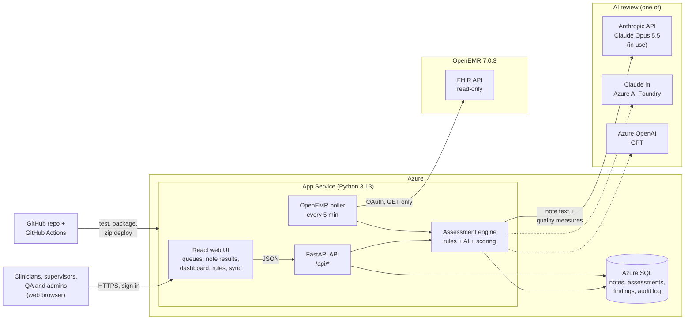
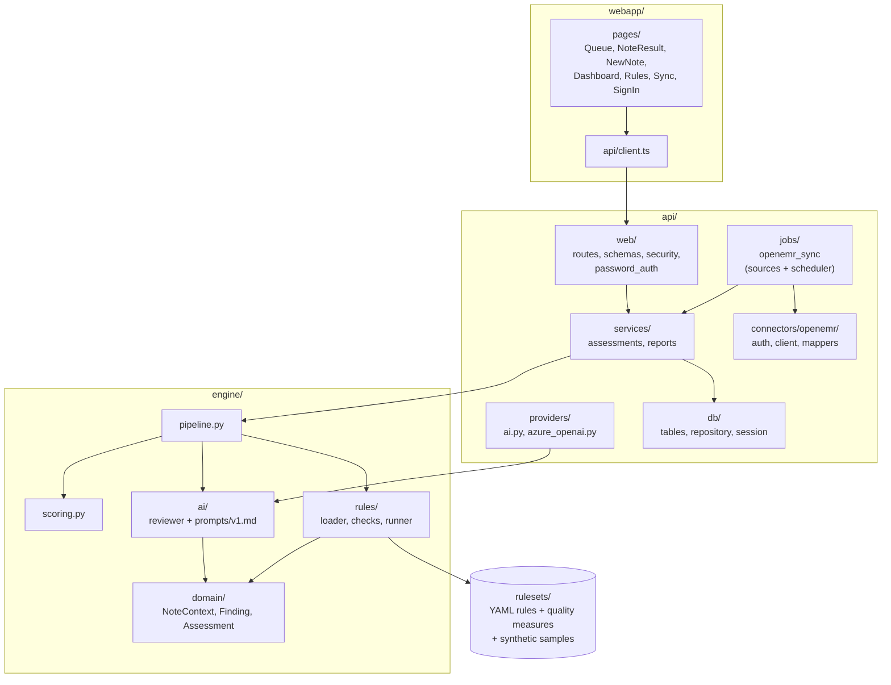
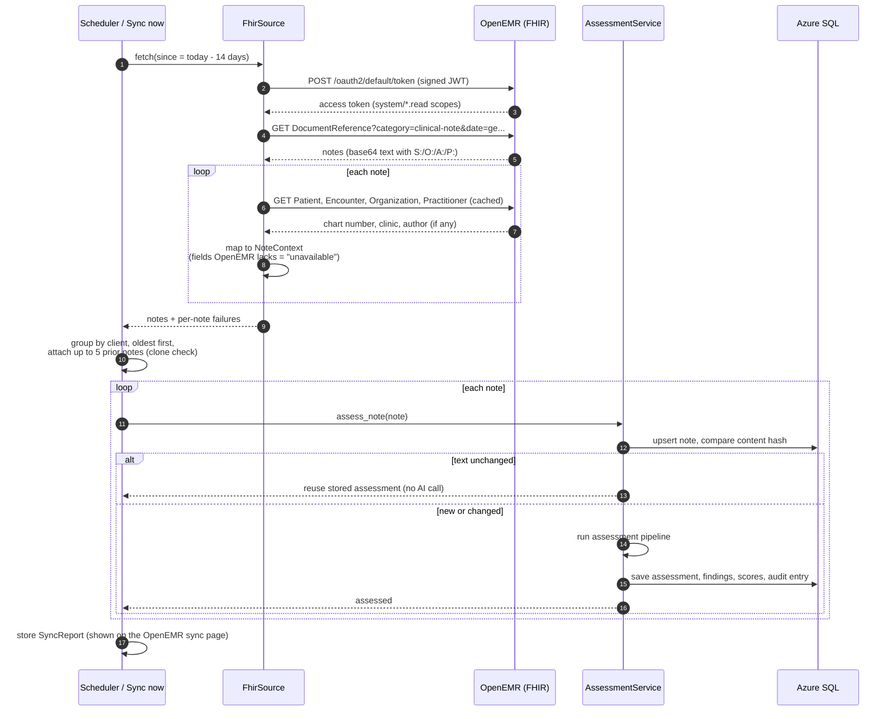
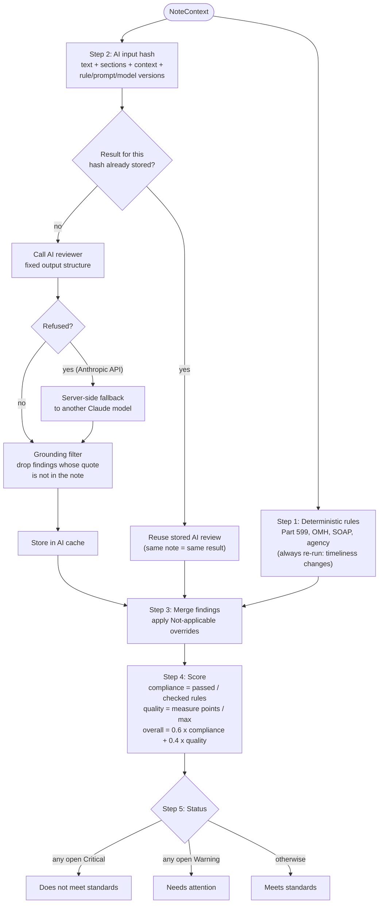
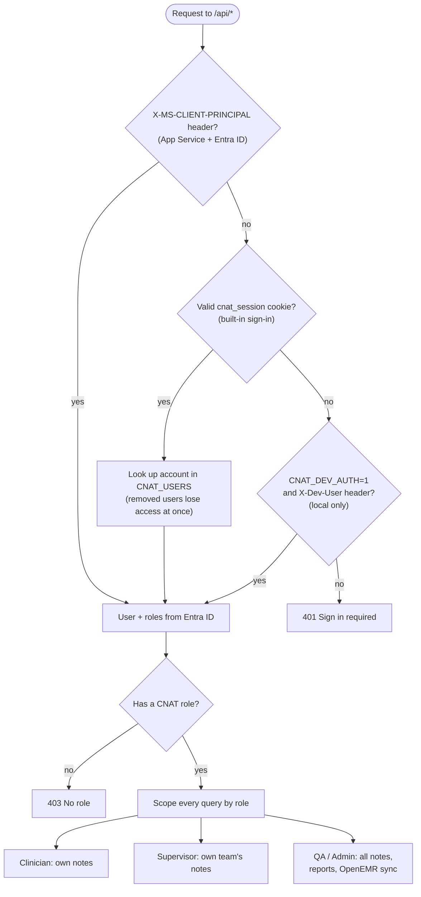
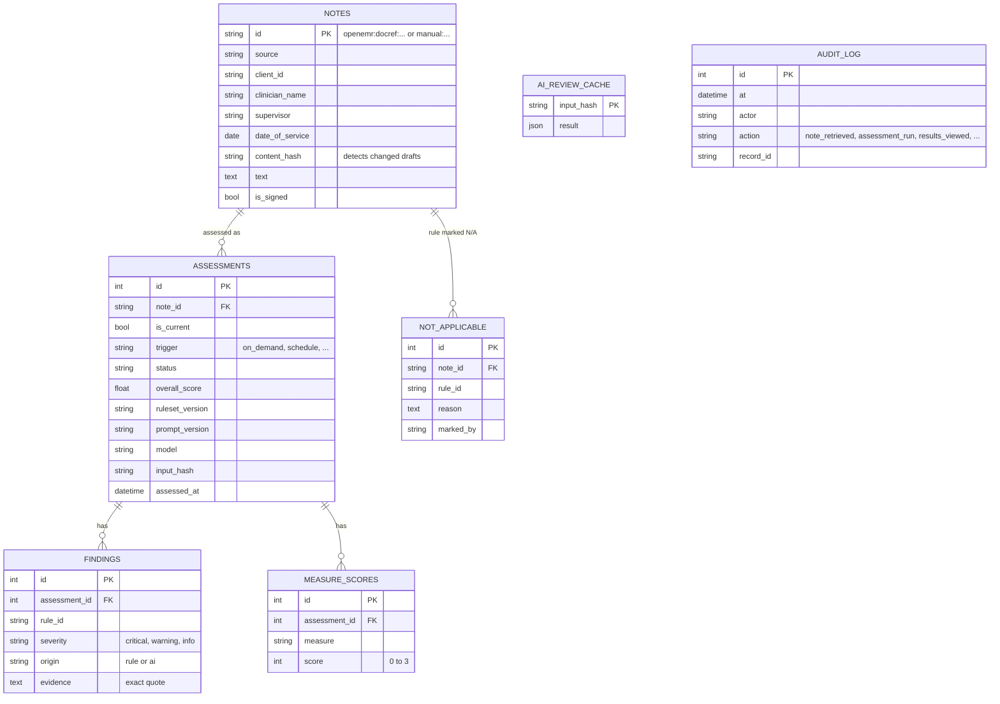
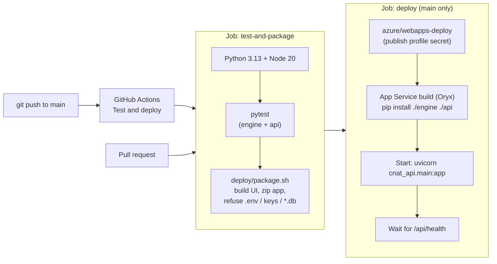

# CNAT architecture

The Clinical Notes Assessment Tool reviews draft clinical notes against NYS OMH Article 31 /
14 NYCRR Part 599, OMH documentation rules, SOAP format and clinical quality measures.
**It only reads and assesses. It never edits, signs or deletes EHR data.**

Diagrams are [Mermaid](https://mermaid.js.org/); GitHub draws them when you open this file.

- [1. System overview](#1-system-overview)
- [2. Code structure](#2-code-structure)
- [3. OpenEMR intake flow](#3-openemr-intake-flow)
- [4. Assessment pipeline](#4-assessment-pipeline)
- [5. Sign-in and access](#5-sign-in-and-access)
- [6. Data model](#6-data-model)
- [7. Build and deploy](#7-build-and-deploy)
- [8. Key design decisions](#8-key-design-decisions)

---

## 1. System overview

Everything runs in **one Azure App Service**: it serves the React UI and the FastAPI API, and runs the
OpenEMR poller in the background. Data lives in **Azure SQL**. The AI review is pluggable.

| Part | Technology | Notes |
|---|---|---|
| Web UI | React 18, TypeScript, Vite, Recharts | Built into `webapp/dist`, served by the API |
| API | FastAPI, Uvicorn | One process; also runs the poller thread |
| Engine | Python package `cnat_engine` | No web or database code; pure assessment logic |
| Rule sets | YAML in `rulesets/` | Versioned (`2026.11.0`); every assessment stores the version |
| Database | Azure SQL Basic (SQLite locally) | SQLAlchemy 2.0 |
| EHR | OpenEMR 7.0.3 FHIR R4 | Clinical Notes form → `DocumentReference` |
| AI | Anthropic API (`claude-opus-5-5`) | Switchable by setting `CNAT_AI_PROVIDER` |
| CI/CD | GitHub Actions | `.github/workflows/deploy.yml` |

---

## 2. Code structure

One repository, four parts. Arrows point from a part to what it depends on.

---

## 3. OpenEMR intake flow

Every 5 minutes, and whenever an admin clicks **Sync now**, CNAT reads recent Clinical Notes from OpenEMR
and assesses only the ones that are new or changed.

Why FHIR and the Clinical Notes form: OpenEMR 7.0.3 accepts system (no-user) tokens only on its FHIR
API, and the SOAP form is not exposed over FHIR. `OPENEMR_API=standard` switches to the SOAP form for
OpenEMR versions that allow system tokens on the Standard API.

---

## 4. Assessment pipeline

The same pipeline runs for OpenEMR notes, pasted notes, uploaded files and re-assessments.

| Step | Where | What it guarantees |
|---|---|---|
| Rules | `engine/rules/checks.py`, `rulesets/*.yaml` | Same input → same result. The risk-language safety check never depends on AI |
| Unavailable fields | `NoteContext.unavailable_fields` | Rules needing data the EHR can't supply return N/A, not false "missing" issues |
| AI review | `engine/ai/reviewer.py`, `api/providers/` | Claude (Anthropic API or Foundry) or GPT (Azure OpenAI); an unconfigured provider means rules only |
| Grounding | `to_review_result` | Every AI finding quotes the note exactly, or says `ABSENT` |
| Versions | stored on each assessment | Rule set version, prompt version and model, for audit and reproducibility |

---

## 5. Sign-in and access

- **In use now:** built-in sign-in. Accounts live in the `CNAT_USERS` app setting with PBKDF2-SHA256
  password hashes, the cookie is signed with `CNAT_SESSION_SECRET`, and 5 wrong passwords lock a username
  for 5 minutes.
- **When Entra ID is available:** turn on App Service Authentication. Its identity header takes priority
  automatically.
- Other people's notes return 404, so a user can't tell whether a note exists.

---

## 6. Data model

`AUDIT_LOG` is append-only. `AI_REVIEW_CACHE` is keyed by the AI input hash, so an unchanged note never
calls the AI twice.

---

## 7. Build and deploy

Configuration lives in **App Service app settings**, never in the package:

| Group | Settings |
|---|---|
| Database | `CNAT_DATABASE_URL` |
| Sign-in | `CNAT_USERS`, `CNAT_SESSION_SECRET` |
| AI review | `CNAT_AI_PROVIDER`, `CNAT_AI_MODEL`, plus the provider's key settings |
| OpenEMR | `OPENEMR_BASE_URL`, `OPENEMR_CLIENT_ID`, `OPENEMR_KEY_ID`, `OPENEMR_PRIVATE_KEY_B64`, `OPENEMR_SCOPES`, `OPENEMR_SYNC_MINUTES`, ... |

`azure-pipelines.yml` (Azure DevOps) is kept as an alternative; it needs hosted parallel jobs.
`deploy/azure.sh` can create the Azure resources from the command line. See [deploy/README.md](../deploy/README.md).

---

## 8. Key design decisions

| Decision | Why |
|---|---|
| Assess only, GET-only EHR client | The tool must never change clinical records |
| Deterministic rules + AI | Rules give repeatable compliance checks; AI judges quality. The risk safety net doesn't depend on AI |
| Fixed AI output structure + exact-quote check | Results are comparable across notes and models, and the AI can't invent content |
| AI result cache by input hash | Same note + same versions = same score; polling costs no AI calls for unchanged notes |
| Versioned rule sets and prompts | Every assessment records what it was judged against |
| Unavailable fields instead of false failures | EHR APIs lack some fields (modality, service code, ...); those rules are skipped, not failed |
| One App Service for UI + API | Simplest Azure setup: one resource, one sign-in, no cross-site calls |
| Pluggable AI provider | Claude via Anthropic API today; Foundry or Azure OpenAI by changing settings |
| All times shown as 12-hour Eastern | e.g. `11/12/2026 2:35 AM ET` |

### Known gaps
- OpenEMR's APIs don't expose e-Sign status, so OpenEMR notes are treated as drafts.
- The dev OpenEMR links new Clinical Notes to the wrong patient (a data issue in that instance) and sends
  no note author, so OpenEMR notes are visible to QA and Admin only.
- The OpenEMR server is plain HTTP and uses synthetic data only. Turn on HTTPS before any real data.
- Before real patient data: a BAA with the AI provider, Entra ID sign-in, and database migrations (Alembic).
